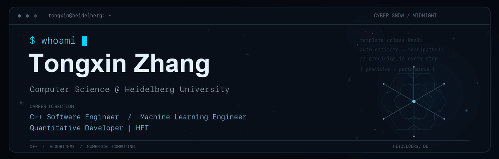
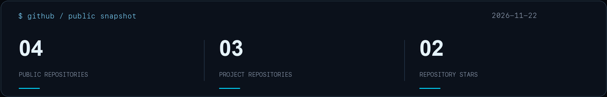

  

<a href="assets/cyber-snow-preview.png">Static banner</a>

# Tongxin Zhang

**Computer Science @ Heidelberg University · Germany**

**My Profile Page:** https://cuzn6666.github.io

**Career direction:** C++ Software Engineer · Machine Learning Engineer · Quantitative Developer (Low-Latency / HFT)

I'm a B.Sc. Computer Science student, graduating in **2027**, with **C++ as my primary language**. I enjoy turning algorithms and numerical methods into clear, testable software—and understanding where the time goes when it runs. My interests connect systems programming, machine learning, and performance engineering, with a long-term focus on HPC, ML systems, and quantitative finance.

[Projects](#featured-projects) · [Experience](#professional-experience) · [Contact](#contact)

## About Me

- **Foundations** — Algorithms, data structures, software engineering, and numerical methods at Heidelberg University.
- **Systems** — C++ design, reproducible builds, debugging, and measured performance improvements.
- **Machine learning** — Neural networks from first principles: forward passes, manual gradients, verification, and explainability.
- **Quantitative computing** — Monte Carlo pricing and numerical statistics; developing toward low-latency systems and HFT engineering.
- **Academic work** — A from-scratch CNN and structured web crawling; numerical computing / uncertainty quantification work **in progress**.

## Tech Stack

| | Area | Technologies |
| :---: | :--- | :--- |
| `</>` | **Languages** | **C++** · Python · Java · TypeScript · SQL |
| `∑` | **ML & numerical computing** | NumPy · Neural Networks · CNN · Numerical Methods · Monte Carlo Simulation |
| `{ }` | **Backend & frontend** | Spring Boot · React · REST APIs · HTML · CSS |
| `$_` | **Development tools** | Linux · Git · CMake · Maven · Docker · GitHub Actions |

## Professional Experience

### Cinemo · Working Student — Software Test Engineering

*Karlsruhe, Germany · October 2023 – October 2024*

Developed **Python automation tooling on Linux** for automotive infotainment testing, reducing test-cycle time by **approximately 50%**. Executed and analyzed **15,000+ system integration tests**, including Apple CarPlay and Android Auto scenarios.

Worked with software engineers to reproduce failures, investigate logs and process states, validate fixes, and improve reliability across the testing workflow.

## Featured Projects

### 01 / C++ Monte Carlo Pricing Engine

`C++17` `CMake` `Monte Carlo` `Numerical Methods`

Prices Asian and lookback options using geometric Brownian motion with **exact discretization**, Monte Carlo estimates, and standard errors. A modular C++ core, mergeable sampling statistics, CTest checks, and single-threaded benchmarks connect numerical correctness with software engineering.

**In progress** · Current implementation is single-threaded. Source not publicly available.

### 02 / [Neural Networks from Scratch](https://github.com/CuZn6666/cnn_adversarial_gradcam_cifar10)

`Python` `NumPy` `CNN` `Gradient Checking` `FGSM / PGD` `Grad-CAM`

A CIFAR-10 CNN with manually implemented forward and backward passes, numerical gradient checks, adversarial evaluation, and Grad-CAM explanations. Focused NumPy optimization reduced the Conv2D backward bottleneck while preserving gradient correctness.

Performance evidence · approximately 208× in a scoped local benchmark

The [recorded benchmark](https://github.com/CuZn6666/cnn_adversarial_gradcam_cifar10/blob/main/deliverables/WP6/runtime_benchmark_after.md) reports **43.459 ms → 0.209 ms** for `Conv2D.backward` (**207.72×**). It used synthetic float32 input `(2, 3, 32, 32)`, 3 input / 8 output channels, a 3×3 kernel, stride 1, padding 1, seed 42, one warm-up, and three measured iterations. Timing uses `time.perf_counter` and averages the iterations.

This is a small local comparison against previously recorded baseline timings, not an end-to-end model speedup or a general hardware benchmark.

### 03 / [Product Integration Studio](https://github.com/CuZn6666/Product-Integration-Studio)

`Java` `Spring Boot` `Maven` `React` `TypeScript` `PrimeReact` `React Flow` `H2`

A full-stack product workspace with validated REST APIs, persistent CRUD, browser-side search and status filtering, and a visual **simulated PLM-to-ERP workflow**. Typed frontend integration, transactional backend logic, and API / UI tests keep behavior explicit and verifiable.

## Competitive Programming

**NOIP Provincial First Prize (2018)** · **SDOI Provincial Selection — Rank 19 (2019)**

An algorithmic foundation in C++, data structures, and solving problems under constraints.

## GitHub Statistics

Public repository snapshot · 22 November 2026 · Stored locally; not a live counter. [Current activity](https://github.com/CuZn6666?tab=overview)

## Contact

[GitHub · @CuZn6666](https://github.com/CuZn6666) · [Email · tongxinzhang369@gmail.com](mailto:tongxinzhang369@gmail.com)

Interested in C++ software engineering, ML systems, and quantitative development opportunities.
